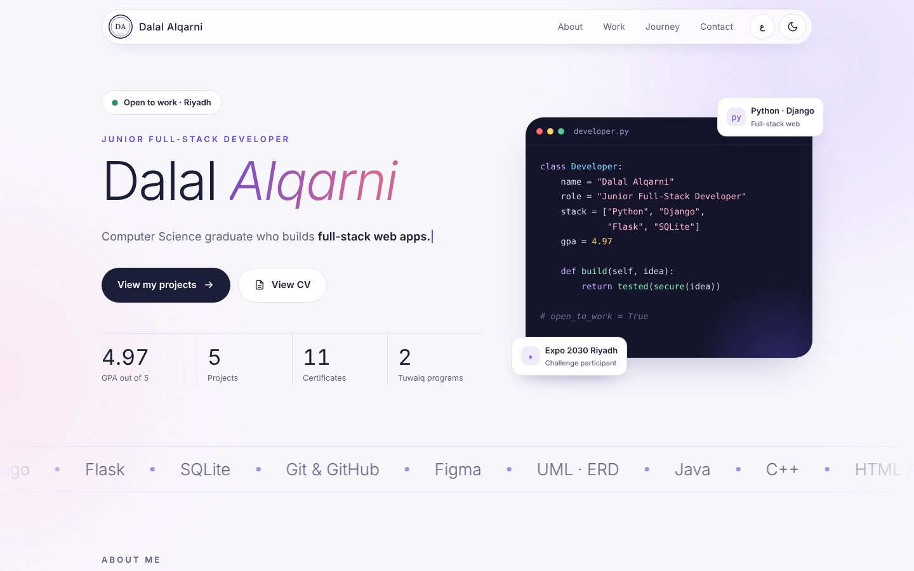
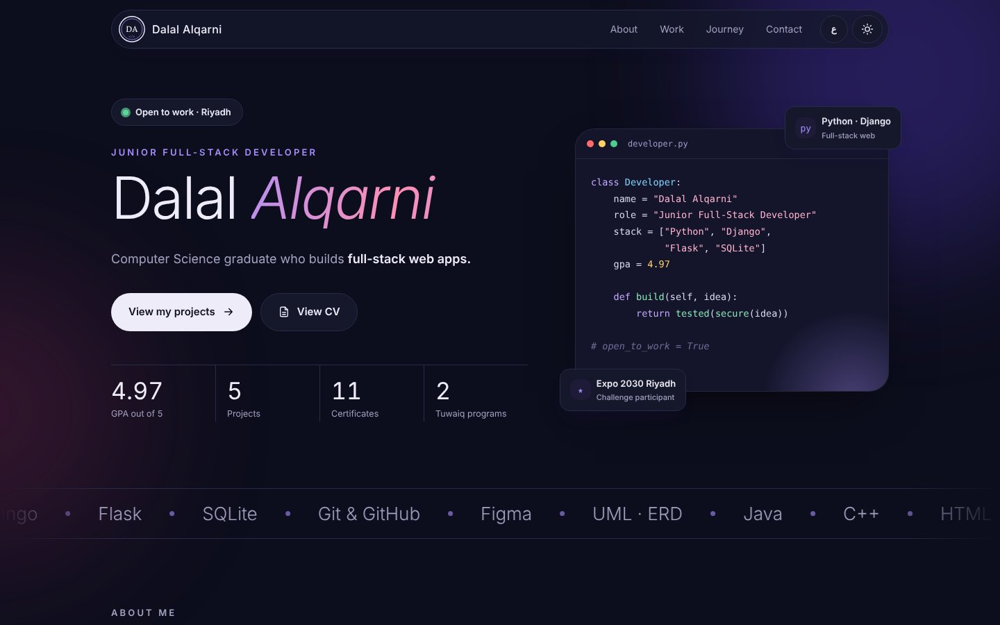

# Dalal Alqarni

**Computer Science Graduate · Junior Full-Stack Developer**

University of Bisha · GPA 4.97 / 5 · Riyadh, Saudi Arabia

---

## 🖥️ Preview

  
  

---

## 👩‍💻 About

I build complete web applications, from the database and server logic to the pages people use. I completed two intensive programs at **Tuwaiq Academy**, competed in the **Expo 2030 Riyadh Challenge**, and hold certifications in AI from **SDAIA** and in cybersecurity.

---

## 📂 Featured Projects

| Project | Description | Tech | Links |
|---|---|---|---|
| **AssetTrace** | IT asset management system that tracks devices, tickets, maintenance costs and replacement decisions. Solo capstone project, built in one week with 3 user roles and 53 automated tests. | Python · Django · SQLite | [Code](https://github.com/dalalalqarni828-bit/DalalAlqarni-Capstone-Project) |
| **EOIP** | Operations intelligence platform that turns hundreds of alerts into a short prioritised list. Built with a team of five at the Expo 2030 Riyadh Challenge, among 65 teams. My part: priority engine, alert merging, decision log and sign-in. | Python · Django · YOLOv8 | [Code](https://github.com/dalalalqarni828-bit/EOIP) · [Demo](https://sarahibr8.github.io/EOIP/) |
| **Self-Scan** | Mobile attendance app using time-limited QR codes and location verification. Graduation project; I designed the UI in Figma and the UML and ERD diagrams. | Flutter · Figma | — |
| **Taskly** | Task management web app with accounts, priorities and a personal dashboard. Team project. | Python · Flask · SQLite | [Code](https://github.com/dalalalqarni828-bit/Group-3---Library-Management-System) |
| **Library System** | Command-line library manager built with object-oriented Python. Team project. | Python · OOP | [Code](https://github.com/dalalalqarni828-bit/Group-3---Library-Management-System) |

---

## 🛠️ Skills

---

## 🎓 Education & Certificates

- **BSc Computer Science**, University of Bisha · GPA 4.97 / 5
- **Web Application Development with Python Bootcamp**, Tuwaiq Academy · 2026
- **Programming Foundation Program**, Tuwaiq Academy · 2026
- **Expo 2030 Riyadh Challenge**, Immersive program by Misk Skills & Tuwaiq Academy · 2026
- **Artificial Intelligence** certifications, SDAIA · 2025
- **Cybersecurity**, Monshaat · 2024

---

## ✨ Portfolio Features

- 🌐 **Bilingual:** English and Arabic, with full right-to-left layout
- 🌗 **Light and dark mode**, following the visitor's device setting
- 📱 **Responsive** on phone, tablet and laptop
- 📄 **CV viewer** built into the page

Built with **HTML, CSS and JavaScript**, hosted on **GitHub Pages**.

---

**Open to new opportunities** · Feel free to reach out

